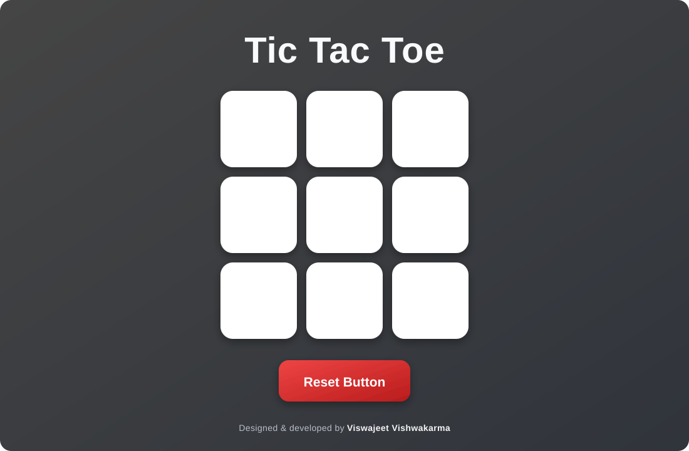

# 🎮 Tic Tac Toe

A classic two-player Tic-Tac-Toe game built with **HTML, CSS, and vanilla JavaScript**.

## 👀 Preview

## ✨ Features

- 🧑‍🤝‍🧑 Two-player gameplay
- 🔄 Reset and New Game buttons
- 🏆 Winner detection
- 📱 Responsive board layout
- 🎨 Styled buttons with interactive hover effects

## 🚀 Run locally

1. Download or clone this project.
2. Open `index.html` in your web browser.
3. Click a square to take a turn.

No installation or build step is required.

## 🕹️ How to play

- Players alternate placing **O** and **X** in an empty square.
- The first player to get three marks in a row, column, or diagonal wins.
- Select **Reset Button** or **New Game** to start again.

## 📁 Project structure

| File | Description |
| --- | --- |
| `index.html` | Game page and 3×3 board |
| `style.css` | Layout, colors, and button styling |
| `app.js` | Turn handling, winner detection, and reset behavior |

## 👨‍💻 Credits

Designed & developed by **Viswajeet Vishwakarma**.
